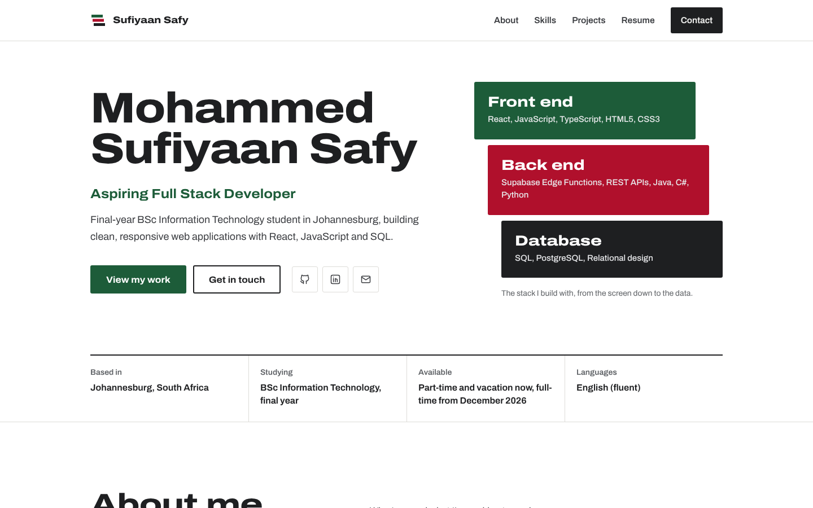

# Mohammed Sufiyaan Safy, Portfolio

My personal portfolio website, built as **Task 1** of the **Future Interns Full Stack Web Development** internship (track code FS).

**Live site:** https://sufiyaansafy.vercel.app



## What it does

- **Introduces me** with my role, a short summary, the stack I build with, and quick facts about where I'm based, what I'm studying and when I'm available.
- **Shows my skills** grouped by languages, front end, databases, tools and concepts.
- **Lists my projects** with a filter for Future Interns tasks, courses and academic work. The three internship tasks show their status and dates, so the page doubles as a build log.
- **Holds my resume:** education, certifications and coursework side by side.
- **Lets people contact me.** A one-click button copies my email address, and the form saves each message to a Supabase database and emails me a notification, with spam and rate-limit protection.
- **Is easy to find.** The page is pre-rendered to plain HTML at build time, with meta tags, Open Graph previews for LinkedIn and WhatsApp, structured data, a sitemap and robots.txt.
- **Works everywhere.** Responsive from 320px phones to wide desktops, with visible keyboard focus, text contrast that meets WCAG AA, and reduced motion respected.

## Design

Three solid colours on white: **charcoal black** for text and dark blocks, **forest green** for buttons and links, and **crimson red** for accents. Every text colour meets WCAG AA contrast against its background; the ratios are noted beside each colour in `src/styles.css`.

The signature element is the hero's stack: three offset blocks labelled front end, back end and database, which build up from the bottom when the page loads. The logo is a miniature of the same stack. Headings use Archivo set wide, and body text uses Archivo at normal width.

## Tech stack

| Layer | Tools |
| --- | --- |
| Front end | React 19, Vite 8, plain CSS |
| Back end | Supabase Edge Function (Deno, TypeScript) |
| Database | Supabase PostgreSQL with Row Level Security |
| Email | Resend API |
| Hosting | Vercel |

## How the contact form works

```
Browser form ──POST JSON──▶ Edge Function "contact" ──insert──▶ contact_messages table
   (React)                    validate, honeypot,      └──────▶ Resend email to me
                              rate limit (3 per 10 min)
```

1. `src/components/Contact.jsx` validates the fields in the browser and shows clear errors.
2. `src/lib/sendMessage.js` sends the data to the Edge Function.
3. `supabase/functions/contact/index.ts` validates again on the server, silently drops bots that fill the hidden "website" field, limits each email address to 3 messages per 10 minutes, saves the message, then emails me through Resend with the sender as the reply-to address.
4. The `contact_messages` table has Row Level Security on with no public policies, so the public can't read or write it directly. Only the Edge Function, using the project's secret key on the server, can insert rows.

## Project structure

```
FUTURE_FS_01/
├── index.html                  SEO tags and structured data
├── public/                     favicon, social preview image, robots.txt, sitemap.xml
├── scripts/prerender.js        turns the React app into static HTML after the build
├── src/
│   ├── data/profile.js         all CV content (edit this to update the site)
│   ├── data/projects.js        project list, statuses and links
│   ├── components/             one file per section
│   ├── lib/sendMessage.js      calls the Edge Function
│   ├── entry-server.jsx        build-time renderer
│   ├── main.jsx                browser entry
│   └── styles.css              design tokens and all styles
└── supabase/
    ├── config.toml             keeps JWT verification off for the public contact function
    └── functions/contact/      the Edge Function
```

## Run it locally

You need [Node.js](https://nodejs.org) 20.19 or newer. Create a `.env` file in the project folder with:

```
VITE_SUPABASE_URL=https://your-project-ref.supabase.co
SITE_URL=https://name.vercel.app
```

Then:

```bash
npm install
npm run dev        # http://localhost:5173
npm run build      # production build with pre-rendering, into dist/
```

Without `VITE_SUPABASE_URL` the site still works; the contact form tells visitors to email me directly.

## Set up the back end

**1. Create the table.** In the Supabase dashboard, open **SQL Editor** and run:

```sql
create table public.contact_messages (
  id          uuid primary key default gen_random_uuid(),
  created_at  timestamptz not null default now(),
  name        text not null check (char_length(name) between 2 and 100),
  email       text not null check (char_length(email) between 5 and 200),
  message     text not null check (char_length(message) between 10 and 5000),
  emailed     boolean not null default false
);

create index contact_messages_email_created_idx
  on public.contact_messages (email, created_at desc);

-- RLS on with no policies: only the Edge Function (server-side secret key) can write.
alter table public.contact_messages enable row level security;
```

**2. Add secrets.** Create an API key at [resend.com](https://resend.com) (sign up with the address that should receive notifications), then add these under **Edge Functions > Secrets**: `RESEND_API_KEY` and `CONTACT_TO_EMAIL`.

**3. Deploy the function.** JWT verification stays off (set in `supabase/config.toml`) because visitors to a public form aren't logged in; validation, the honeypot and the rate limit protect it instead.

```bash
npx supabase login
npx supabase functions deploy contact --no-verify-jwt --project-ref YOUR_PROJECT_REF
```

## Deploy

The site is hosted on Vercel from this repository. Vercel detects Vite automatically; the project needs two environment variables, `VITE_SUPABASE_URL` and `SITE_URL` (the live address, no trailing slash). Every push to `main` redeploys the site, and `SITE_URL` fills in the canonical link, social preview image, structured data, robots.txt and sitemap.

## Credits

- Built during the [Future Interns](https://futureinterns.com) Full Stack Web Development internship, October 2026.
